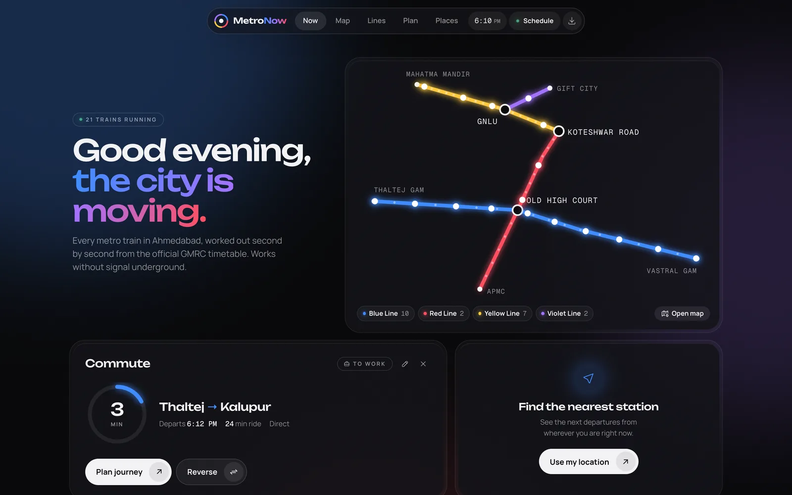
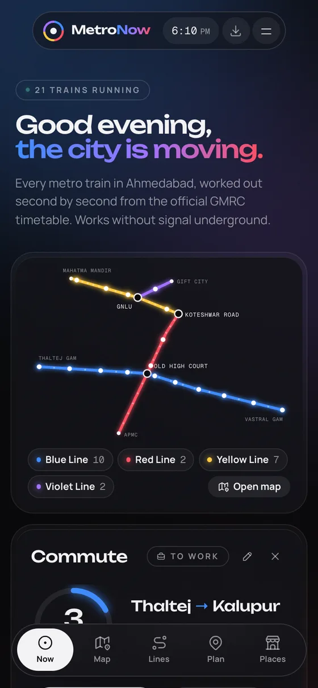
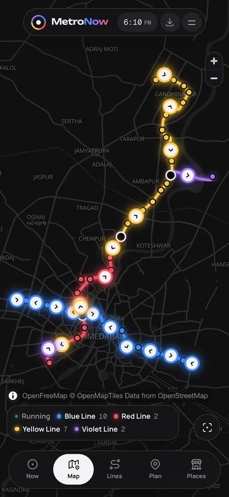
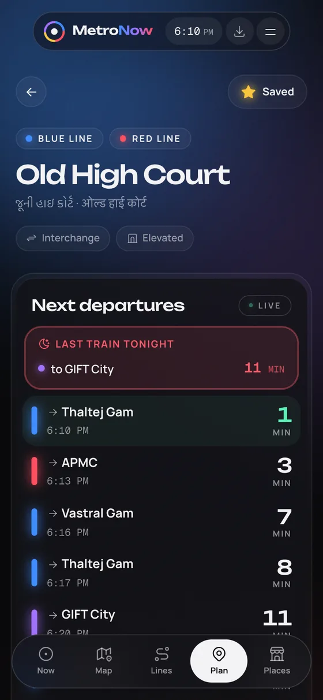
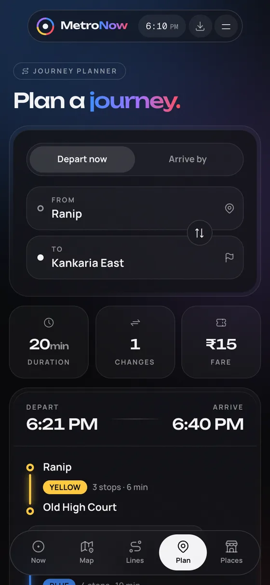

# MetroNow

### Every metro train in Ahmedabad, right in your pocket.

Know when your train leaves, where it is right now, and the quickest way to reach any station. 
No sign up. No ads. It keeps working even when your signal does not.

 

&nbsp;

&nbsp;

 

---

## Why MetroNow

Picture yourself on the platform, or rushing towards it. All you want to know is one thing: when is the next train?

MetroNow answers that the moment you open it, and then gives you everything else you might need. Every train on the Blue, Red, Yellow and Violet lines moves across a map, positioned by the official timetable. Every station has its own departure board that counts down to the minute. The journey planner shows you the quickest route, where to change and exactly what the ticket costs, all before you reach the gate.

It was made for daily commutes. It opens instantly, keeps working underground, and remembers the trip you take every day.

<table>
  <tr>
    <td align="center"> <b>Your city at a glance</b></td>
    <td align="center"> <b>Every train on the map</b></td>
    <td align="center"> <b>Departures, to the minute</b></td>
    <td align="center"> <b>Plan any journey</b></td>
  </tr>
</table>

---

## What you can do

**🚇 See the whole network at a glance**
Watch every train glide along its line, either on a clean route diagram or on a full map of the city. Tap any train to see where it is heading and how many stops it has left.

**⏱ Stop guessing departure times**
Every station lists its next trains with countdowns that tick down to the minute, and gives you a heads up when the last train of the night is about to leave.

**🧭 Reach any station the quickest way**
Pick two stations and you get the fastest route, every change, how long you will wait at each interchange and the exact fare. Need to be somewhere by a certain time? Switch to **Arrive by** and MetroNow works backwards for you.

**🏠 Your commute, one tap away**
Save your home and work stations once. From then on, MetroNow shows a countdown to your next train and flips around for the ride back.

**📍 Find the nearest station, wherever you are**
Use your location, or search for any place in Ahmedabad: a mall, a hospital, a college, the railway station or Kankaria Lake. MetroNow tells you the closest station and whether it is a short walk or a better idea to take an auto.

**⭐ Favourites on your home screen**
Star the stations you use most and see their departures the moment you open the app.

**🔗 Share a trip**
Send a journey to a friend as a link. It opens with the route already planned for them.

**🗣 Speaks your language**
Search for stations in English, ગુજરાતી or हिन्दी.

---

## Built for everyday life

| | |
|---|---|
| **Works offline** | The full timetable lives on your phone. Underground, in airplane mode or on a weak network, it still works. |
| **Fast** | It opens in a blink and stays smooth on everyday phones. |
| **Private** | No account, no tracking and no ads. Your location is used only on your phone and is never sent anywhere. [Read the privacy policy](https://metro.bhavyladani.in/privacy) |
| **Easy on the eyes** | A calm dark design where the four line colours glow, so you can read it at a glance and comfortably at night. |
| **On every screen** | Phone, tablet or laptop, it is the same app, shaped for each one. |

---

## Get MetroNow

**🤖 Android**
* **Google Play:** coming soon.
* **Right now:** [download the APK](https://github.com/bhavy67/ahmedabad-metro-tracker/releases/latest/download/MetroNow.apk), open it, and allow installing from that source when your phone asks.
* You can also open [metro.bhavyladani.in](https://metro.bhavyladani.in) in Chrome and tap the install icon in the top bar.

**🍎 iPhone and iPad**
Open [metro.bhavyladani.in](https://metro.bhavyladani.in) in **Safari**, tap **Share**, then choose **Add to Home Screen**. It opens full screen, just like any other app.

**💻 Desktop**
Simply visit [metro.bhavyladani.in](https://metro.bhavyladani.in), or click the install icon in Chrome or Edge to keep it handy.

> Once MetroNow arrives on Google Play, please remove the APK version first and then install it from Play, so you get updates automatically.

---

## Questions

**Is this an official app?**
No. MetroNow is an independent, unofficial app, made by a rider for fellow riders. It is not affiliated with or endorsed by Gujarat Metro Rail Corporation (GMRC).

**Is it live tracking?**
No. GMRC does not publish a real time train feed, so MetroNow works out where every train should be, second by second, from the published GMRC timetable. That is accurate whenever trains run on schedule, but it cannot see delays or disruptions.

**How up to date is the timetable?**
You can see the date the current timetable took effect inside the app by tapping **Schedule** in the top bar. Whenever timings change, MetroNow gets updated, and every installed copy picks up the new timetable on its own.

**Does it cost anything?**
Not a rupee. It is free, with no ads and nothing to buy inside the app.

**I spotted a wrong timing or a bug.**
Please [let us know here](https://github.com/bhavy67/ahmedabad-metro-tracker/issues). Every report makes MetroNow better for everyone.

---

## For developers

MetroNow is open source. Setup, architecture, releases, caching and the Android build are all covered in **[docs/DEVELOPMENT.md](docs/DEVELOPMENT.md)**.

---

Made with care in Ahmedabad by **[Bhavy Ladani](https://bhavyladani.in)** 
Originally started by Darshan Patel · Timetable from GMRC · Maps © OpenStreetMap contributors and OpenFreeMap · Place search by Nominatim

MetroNow is not affiliated with Gujarat Metro Rail Corporation (GMRC).

